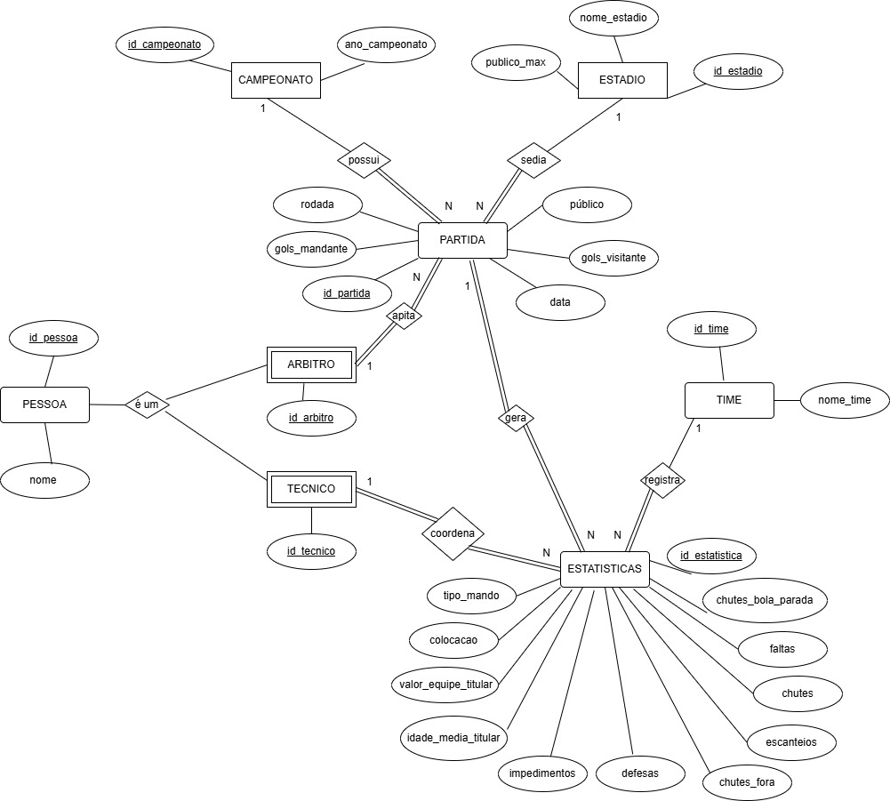
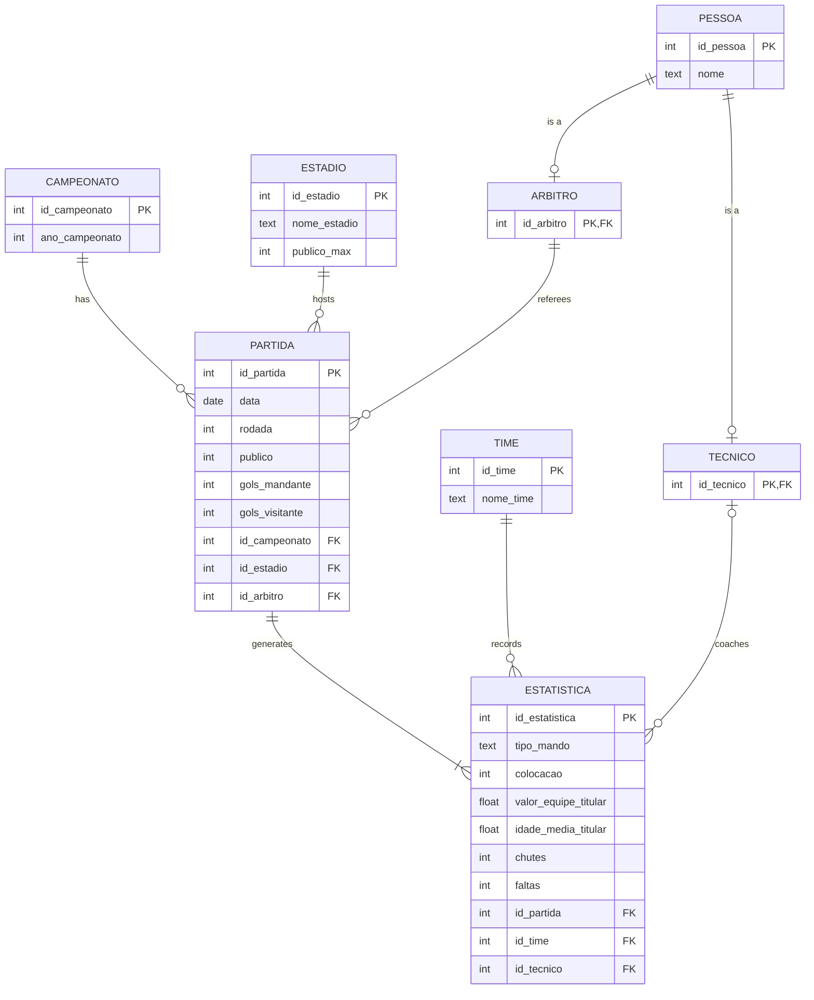
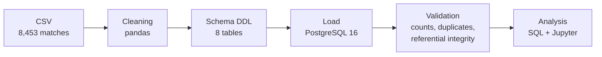
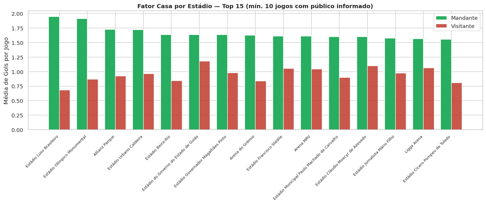

# Brasileirão DB Analysis

**English** | [Português](README.pt-BR.md)


An end-to-end database project built on open data from the **Brazilian Football Championship (Série A)**: conceptual modeling (ER/EER), a relational schema normalized to 3NF, a Python ETL pipeline that cleans the raw data and loads it into PostgreSQL with integrity checks, and SQL-driven exploratory analysis.

Developed for the Introduction to Databases course (Systems Engineering, Universidade Federal de Minas Gerais, 2026). The full report (in Portuguese) is in [`docs/relatorio.pdf`](docs/relatorio.pdf).

---

## Highlights

- **From a flat file to a relational database.** A single 8,453-row CSV with 35 columns per match was modeled into 8 tables, including a `pessoa` superclass specialized into `tecnico` (coach) and `arbitro` (referee).
- **Normalized to 3NF.** Every table has primary and foreign keys, and domain rules are enforced with `CHECK` and `UNIQUE` constraints.
- **Reproducible ETL.** One Python script cleans the data, creates the schema, loads it into PostgreSQL running in Docker, and validates the result.
- **Clean load.** 6,731 matches and 13,462 team statistics (two per match) were loaded, with 0 domain violations, 0 duplicate keys and 0 referential-integrity failures.
- **Four analytical questions in SQL**, using CTEs, window functions, subqueries, `HAVING`, `CASE` and `NULLIF`, with charts in a Jupyter notebook.

## Data

The source is the *Campeonato Brasileiro Série A* table from [Base dos Dados](https://basedosdados.org/dataset/c861330e-bca2-474d-9073-bc70744a1b23?table=18835b0d-233e-4857-b454-1fa34a81b4fa), with Transfermarkt data. It covers 2003 to 2024 and has one row per match: teams, coaches, referee, stadium, attendance, score, squad value, average age and match statistics.

## Data model

<p align="center">
  
</p>

Relational schema (the image version is in [`docs/diagrams/relational_diagram.png`](docs/diagrams/relational_diagram.png)):



Coaches and referees share the `pessoa` table because the same person can hold both roles across seasons. Each match has two rows in `estatistica`, one for the home team (`mandante`) and one for the away team (`visitante`). The diagram shows the main statistics columns; the full list (corners, saves, offsides, set-piece shots, shots off target) is in [`src/criar_banco.py`](src/criar_banco.py).

## ETL pipeline



Cleaning steps in [`src/criar_banco.py`](src/criar_banco.py):

- Standardizes team names that appear with different spellings (for example `Santos FC` → `Santos`).
- Converts numeric fields and dates, turning unparseable values into nulls.
- Drops matches missing required fields. Seasons 2003 to 2006 have no referee recorded, so the database covers **2007 to 2024**.
- Removes duplicates, both exact and by the natural key (season, date, round, home team, away team).
- Applies domain rules, such as non-negative goals and statistics and positive capacity and average age.

| Table | Rows |
|---|---|
| `partida` (matches) | 6,731 |
| `estatistica` (team stats per match) | 13,462 |
| `time` (teams) | 41 |
| `estadio` (stadiums) | 82 |
| `arbitro` (referees) | 208 |
| `tecnico` (coaches) | 273 |
| `campeonato` (seasons) | 18 |

## Analysis

All four questions are answered in [`notebooks/analise_exploratoria.ipynb`](notebooks/analise_exploratoria.ipynb), which queries PostgreSQL directly.

| # | Question | SQL features |
|---|---|---|
| 1 | Which stadiums give the home team the biggest attacking advantage? | `JOIN`, `GROUP BY`, `HAVING`, `AVG` |
| 2 | Do more expensive squads need fewer shots per goal? | CTE, `CASE`, `NULLIF`, `ROUND` |
| 3 | Which referees call the most fouls compared with the league average? | Window function (`OVER`), subquery, `COUNT(DISTINCT)` |
| 4 | Is the starting XI's average age related to final league position? | `MIN`, `MAX`, `AVG`, `GROUP BY` |

<p align="center">
  
</p>

Main findings:

- **Home advantage is strong across stadiums.** Among the 15 stadiums with the highest home scoring (at least 10 matches), home teams average 1.56 to 1.95 goals per match, against 0.68 to 1.18 for visitors.
- **Age barely changes with league position.** The average age of the starting XI stays between 27.0 and 27.4 years from 1st to 20th place, so the data shows no clear link between experience and position.
- **Referee profiles vary.** Most of the top 20 referees average 31 to 44 fouls per match, against a league average of 30. One referee with only 7 matches averages 97 fouls, which looks like a data-quality problem rather than a real pattern.

### Data notes

Shot and foul statistics only exist from **2018 onward** (partially in 2018 and 2019). Goals, by contrast, cover every season. For question 2, this means shots per goal mixes goals from all seasons with shots from recent ones only, so the ranking mostly reflects which seasons each team played rather than finishing efficiency. A fairer version would compute the ratio only over matches with shot data. The 2024 season is also incomplete in the source (283 matches).

## Repository structure

```
├── src/
│   └── criar_banco.py             # ETL: cleaning, DDL, load and validation
├── notebooks/
│   └── analise_exploratoria.ipynb # SQL analysis and charts
├── data/
│   └── brasileirao.csv            # raw dataset (Base dos Dados)
├── figures/                       # charts exported from the notebook
├── docs/
│   ├── relatorio.pdf              # full report (Portuguese)
│   ├── slides_apresentacao.pptx   # presentation slides
│   ├── apresentacao.mp4           # recorded presentation
│   └── diagrams/                  # ER and relational diagrams
├── docker-compose.yml             # PostgreSQL 16
├── .env.example                   # database settings
└── requirements.txt
```

## Running it

Requires Docker and Python 3. Run everything from the repository root.

```bash
# 1. Database settings
cp .env.example .env

# 2. Python environment
python -m venv .venv
source .venv/bin/activate        # Windows: .venv\Scripts\activate
pip install -r requirements.txt

# 3. Start PostgreSQL
docker compose up -d

# 4. Create the schema, load the data and run the validations
python src/criar_banco.py

# 5. Explore the analysis
jupyter notebook notebooks/analise_exploratoria.ipynb
```

The script drops and recreates all tables on every run, so it can be executed again safely.

## Authors

- **Samuel Lima Horta**: [GitHub](https://github.com/samucao1803)
- **Thiago Tobias Valente de Oliveira Santos**
- **Bernardo Soares Diniz Lara**
- **Luigi Pinesi Tavares Jacob**

Systems Engineering, Universidade Federal de Minas Gerais (UFMG), Belo Horizonte, Brazil.
