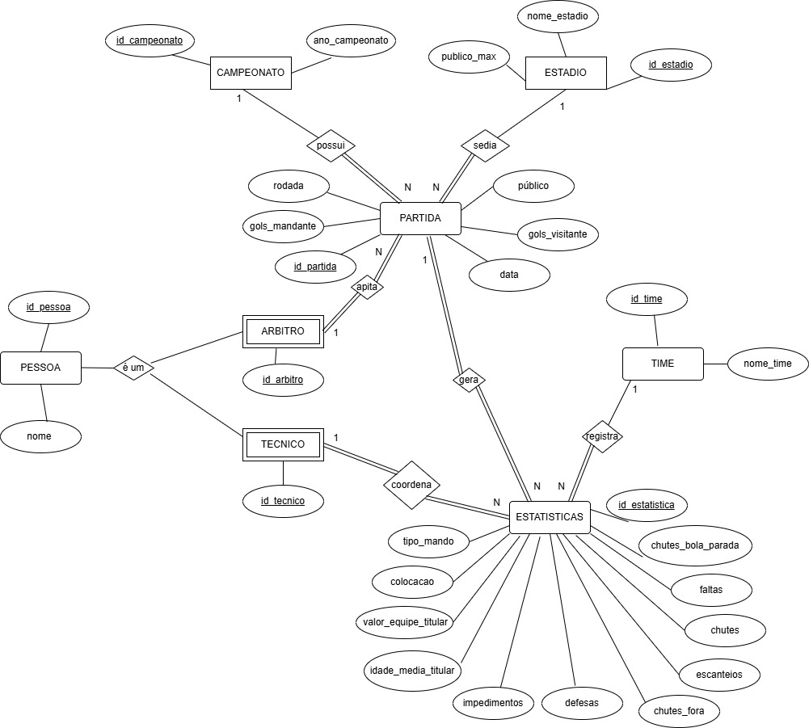
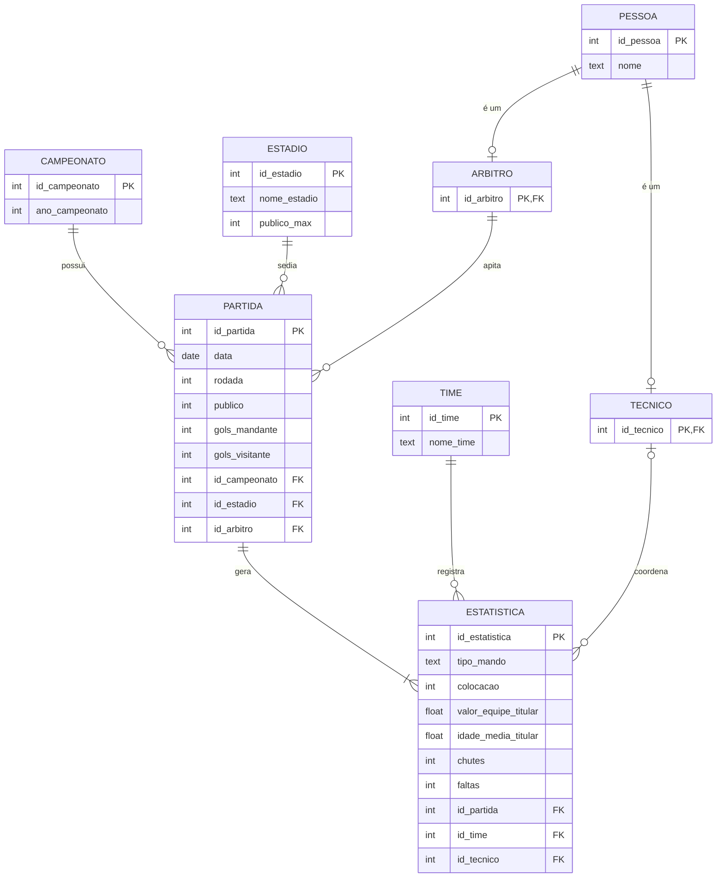
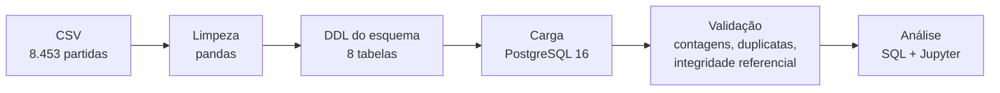
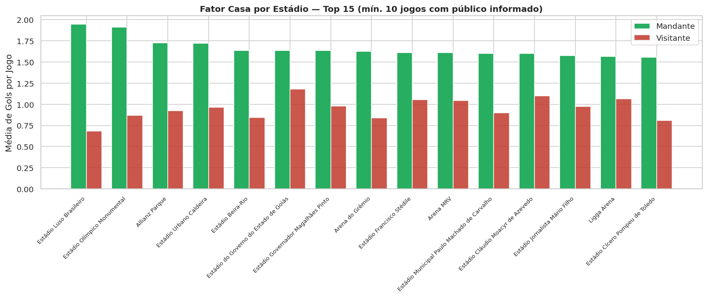

# Brasileirão DB Analysis

[English](README.md) | **Português**


Projeto completo de banco de dados construído sobre dados abertos do **Campeonato Brasileiro Série A**. Ele vai da modelagem conceitual (ER/EER) a um esquema relacional normalizado até a 3FN, passando por um pipeline de ETL em Python que limpa os dados brutos e os carrega no PostgreSQL com validações de integridade, até uma análise exploratória feita em SQL.

Trabalho prático da disciplina Introdução a Banco de Dados (Engenharia de Sistemas, Universidade Federal de Minas Gerais, 2026). O relatório completo está em [`docs/relatorio.pdf`](docs/relatorio.pdf).

---

## Destaques

- **De um arquivo plano a um banco relacional.** Um único CSV de 8.453 linhas, com 35 colunas por partida, foi modelado em 8 tabelas, incluindo a superclasse `pessoa`, especializada em `tecnico` e `arbitro`.
- **Normalização até a 3FN.** Todas as tabelas têm chaves primárias e estrangeiras, e as regras de domínio são garantidas por restrições `CHECK` e `UNIQUE`.
- **ETL reprodutível.** Um único script em Python limpa os dados, cria o esquema, carrega tudo no PostgreSQL rodando em Docker e valida o resultado.
- **Carga sem erros.** Foram carregadas 6.731 partidas e 13.462 estatísticas de time (duas por partida), com 0 violações de domínio, 0 chaves duplicadas e 0 falhas de integridade referencial.
- **Quatro perguntas analíticas em SQL**, usando CTEs, funções de janela, subconsultas, `HAVING`, `CASE` e `NULLIF`, com gráficos em um notebook Jupyter.

## Dados

A fonte é a tabela do *Campeonato Brasileiro Série A* da [Base dos Dados](https://basedosdados.org/dataset/c861330e-bca2-474d-9073-bc70744a1b23?table=18835b0d-233e-4857-b454-1fa34a81b4fa), com dados do Transfermarkt. Ela cobre de 2003 a 2024, com uma linha por partida: times, técnicos, árbitro, estádio, público, placar, valor do elenco, idade média e estatísticas do jogo.

## Modelagem

<p align="center">
  
</p>

Esquema relacional (a versão em imagem está em [`docs/diagrams/relational_diagram.png`](docs/diagrams/relational_diagram.png)):



Técnicos e árbitros ficam na mesma tabela `pessoa` porque a mesma pessoa pode exercer os dois papéis ao longo das temporadas. Cada partida tem duas linhas em `estatistica`, uma para o mandante e outra para o visitante. O diagrama mostra as principais colunas de estatística; a lista completa (escanteios, defesas, impedimentos, chutes de bola parada, chutes para fora) está em [`src/criar_banco.py`](src/criar_banco.py).

## Pipeline de ETL



Etapas de limpeza em [`src/criar_banco.py`](src/criar_banco.py):

- Padroniza nomes de times que aparecem escritos de formas diferentes (por exemplo, `Santos FC` → `Santos`).
- Converte campos numéricos e datas, transformando valores inválidos em nulos.
- Descarta partidas sem os campos obrigatórios. As temporadas de 2003 a 2006 não têm árbitro registrado, por isso o banco cobre **2007 a 2024**.
- Remove duplicatas, tanto exatas quanto pela chave natural (temporada, data, rodada, mandante e visitante).
- Aplica regras de domínio, como gols e estatísticas não negativos e capacidade e idade média positivas.

| Tabela | Registros |
|---|---|
| `partida` | 6.731 |
| `estatistica` (estatísticas de time por partida) | 13.462 |
| `time` | 41 |
| `estadio` | 82 |
| `arbitro` | 208 |
| `tecnico` | 273 |
| `campeonato` (temporadas) | 18 |

## Análises

As quatro perguntas são respondidas em [`notebooks/analise_exploratoria.ipynb`](notebooks/analise_exploratoria.ipynb), que consulta o PostgreSQL diretamente.

| # | Pergunta | Recursos de SQL |
|---|---|---|
| 1 | Em quais estádios o mandante tem maior vantagem ofensiva? | `JOIN`, `GROUP BY`, `HAVING`, `AVG` |
| 2 | Elencos mais caros precisam de menos chutes por gol? | CTE, `CASE`, `NULLIF`, `ROUND` |
| 3 | Quais árbitros marcam mais faltas em relação à média do campeonato? | Função de janela (`OVER`), subconsulta, `COUNT(DISTINCT)` |
| 4 | A idade média do time titular tem relação com a colocação final? | `MIN`, `MAX`, `AVG`, `GROUP BY` |

<p align="center">
  
</p>

Principais achados:

- **O fator casa é forte em todos os estádios.** Nos 15 estádios com maior média de gols do mandante (mínimo de 10 jogos), o mandante marca de 1,56 a 1,95 gol por partida, contra 0,68 a 1,18 do visitante.
- **A idade quase não muda com a colocação.** A idade média do time titular fica entre 27,0 e 27,4 anos do 1º ao 20º lugar, então os dados não mostram uma relação clara entre experiência e posição.
- **O perfil dos árbitros varia.** A maioria dos 20 árbitros com mais faltas marca de 31 a 44 por partida, contra uma média geral de 30. Um árbitro com apenas 7 jogos tem média de 97 faltas, o que parece um problema de qualidade dos dados, e não um padrão real.

### Observações sobre os dados

As estatísticas de chutes e faltas só existem a partir de **2018** (parcialmente em 2018 e 2019). Os gols, por outro lado, cobrem todas as temporadas. Na pergunta 2, isso faz com que os chutes por gol misturem gols de todas as temporadas com chutes só das mais recentes, e o ranking reflete mais as temporadas que cada time disputou do que a eficiência de finalização. Uma versão mais justa calcularia a razão só nas partidas que têm dados de chutes. A temporada de 2024 também está incompleta na fonte (283 partidas).

## Estrutura do repositório

```
├── src/
│   └── criar_banco.py             # ETL: limpeza, DDL, carga e validação
├── notebooks/
│   └── analise_exploratoria.ipynb # análises em SQL e gráficos
├── data/
│   └── brasileirao.csv            # dataset bruto (Base dos Dados)
├── figures/                       # gráficos exportados do notebook
├── docs/
│   ├── relatorio.pdf              # relatório completo
│   ├── slides_apresentacao.pptx   # slides da apresentação
│   ├── apresentacao.mp4           # apresentação gravada
│   └── diagrams/                  # diagramas ER e relacional
├── docker-compose.yml             # PostgreSQL 16
├── .env.example                   # configurações do banco
└── requirements.txt
```

## Como executar

Requer Docker e Python 3. Rode tudo a partir da raiz do repositório.

```bash
# 1. Configurações do banco
cp .env.example .env

# 2. Ambiente Python
python -m venv .venv
source .venv/bin/activate        # Windows: .venv\Scripts\activate
pip install -r requirements.txt

# 3. Subir o PostgreSQL
docker compose up -d

# 4. Criar o esquema, carregar os dados e rodar as validações
python src/criar_banco.py

# 5. Abrir as análises
jupyter notebook notebooks/analise_exploratoria.ipynb
```

O script apaga e recria todas as tabelas a cada execução, então pode ser rodado de novo sem problemas.

## Autores

- **Samuel Lima Horta**: [GitHub](https://github.com/samucao1803)
- **Thiago Tobias Valente de Oliveira Santos**
- **Bernardo Soares Diniz Lara**
- **Luigi Pinesi Tavares Jacob**

Engenharia de Sistemas, Universidade Federal de Minas Gerais (UFMG), Belo Horizonte, Brasil.
